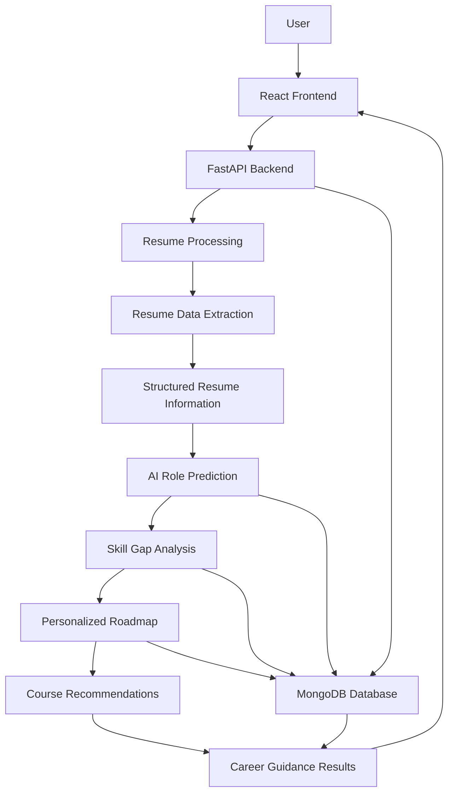
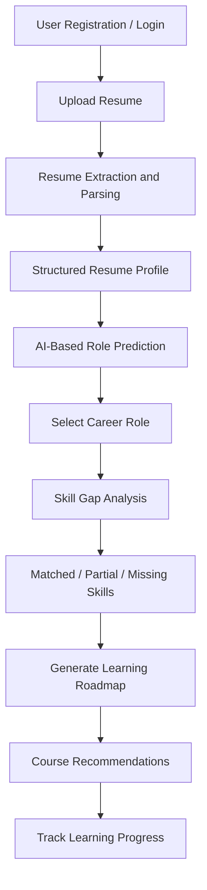

# SkillBridge – AI-Powered Resume Analysis & Career Guidance

SkillBridge is an AI-powered career guidance platform that helps users understand their professional profile, identify skill gaps, explore suitable career opportunities, and follow structured learning roadmaps.

The platform combines resume parsing, natural language processing, AI-based role prediction, skill gap analysis, and personalized course recommendations to support career development.

---

## 1. Project Overview

Choosing the right career path requires an understanding of existing skills, industry requirements, and the learning needed to bridge skill gaps.

SkillBridge addresses this challenge by analyzing a user's resume and providing career-related insights through an integrated AI-powered workflow.

The system helps users:

- Upload and analyze resumes.
- Extract structured information from resumes.
- Identify relevant career roles based on resume content.
- Compare existing skills with role-specific requirements.
- Identify matched, partially matched, and missing skills.
- Generate personalized learning roadmaps.
- Discover relevant certification courses and learning resources.
- Track progress through the recommended roadmap.

## 2. Key Features

### 2.1 Resume Upload and Analysis

- Supports PDF and DOCX resume formats.
- Extracts relevant information from uploaded resumes.
- Processes resume information into structured data.
- Identifies skills, education, experience, and project details.
- Makes the extracted information available for subsequent career analysis.

### 2.2 AI-Based Role Prediction

- Analyzes the candidate's resume information.
- Identifies relevant technical skills and professional experience.
- Predicts suitable career roles based on the candidate's profile.
- Provides role recommendations to support career exploration.

### 2.3 Skill Gap Analysis

- Evaluates the candidate's skills against the selected career role.
- Classifies skills into:
  - Matched Skills
  - Partially Matched Skills
  - Missing Skills
- Calculates a skill match percentage.
- Identifies areas that require further learning and improvement.

### 2.4 Personalized Learning Roadmap

- Generates a structured learning roadmap for the selected career role.
- Organizes required learning into phases.
- Provides a progression path based on identified skill gaps.
- Supports roadmap progress tracking.

### 2.5 Course Recommendations

- Recommends learning resources relevant to identified skill gaps.
- Includes certification-based and free learning resources.
- Supports beginner and advanced learning levels.
- Connects course suggestions with the recommended learning roadmap.

### 2.6 Progress Tracking

- Supports tracking of roadmap learning activities.
- Records completed skills and learning progress.
- Helps users monitor their progress towards career goals.

## 3. System Architecture

SkillBridge follows a modular client-server architecture.



### Architecture Components

| Component | Responsibility |
|---|---|
| Frontend | User interface, resume upload, results, and progress display |
| Backend | API handling, authentication, workflow coordination, and business logic |
| ML / Resume Processing | Resume text extraction, structured parsing, and skill identification |
| AI Services | Role prediction, skill gap analysis, and roadmap generation |
| Database | Storage and retrieval of application data |
| Ollama | Local language model inference for supported AI workflows |

## 4. Technology Stack

| Layer | Technologies |
|---|---|
| Frontend | React.js, Vite, JavaScript, Tailwind CSS |
| Backend | Python, FastAPI |
| Database | MongoDB |
| AI / LLM | Ollama, Llama 3.2 |
| Resume Processing | pdfplumber, PyMuPDF, python-docx, pytesseract |
| NLP and Skill Matching | spaCy, RapidFuzz |
| API Communication | REST APIs |
| Version Control | Git and GitHub |

## 5. AI and Machine Learning Components

### Resume Parsing

The resume-processing module extracts text from uploaded PDF and DOCX documents and converts the information into structured data.

### Role Prediction

The role prediction service analyzes resume information and generates suitable career-role recommendations using an LLM-based workflow.

### Skill Gap Analysis

The skill gap analyzer compares the candidate's profile with the competencies required for a selected role.

The analysis classifies competencies as matched, partially matched, or missing and calculates the overall match percentage.

### Roadmap Generation

The roadmap service uses the selected career role and identified skill requirements to generate a structured learning plan.

### Course Suggestions

The course recommendation workflow provides relevant learning resources to help candidates address their skill gaps.

## 6. Application Workflow



## 7. Project Structure

The repository is organized into separate frontend, backend, and machine-learning components.

```text
skill_bridge/
│
├── backend/
│   ├── app/
│   │   ├── routes/
│   │   └── services/
│   ├── tests/
│   ├── main.py
│   └── requirements.txt
│
├── frontend/
│   ├── src/
│   │   ├── api/
│   │   └── pages/
│   └── package.json
│
├── ml/
│   ├── resume_extractor.py
│   ├── resume_parser.py
│   ├── skills_taxonomy.json
│   ├── main.py
│   └── docs/
│
└── README.md
```

*Note: This is a high-level representation. Individual files and folders may vary as the project evolves.*

## 8. Installation and Setup

### Prerequisites

Install the following software before running the project:

- Python
- Node.js and npm
- MongoDB
- Ollama
- Git

### Step 1: Clone the Repository

```bash
git clone https://github.com/Padmapv28/skill_bridge.git
cd skill_bridge
```

### Step 2: Backend Setup

Open a terminal in the project directory.

```powershell
cd backend
python -m venv venv
```

Activate the virtual environment:

```powershell
.\venv\Scripts\Activate.ps1
```

Install dependencies:

```powershell
pip install -r requirements.txt
```

Start the backend:

```powershell
python -m uvicorn main:app --port 8000 --workers 1
```

Backend address:

```text
http://localhost:8000
```

### Step 3: Frontend Setup

Open another terminal:

```powershell
cd frontend
npm install
npm run dev
```

The frontend is generally available at:

```text
http://localhost:5173
```

### Step 4: Database Setup

Configure MongoDB according to the application's environment configuration.

Ensure that the backend can connect to the configured MongoDB instance before using the application.

### Step 5: Ollama Setup

Install and start Ollama.

Pull the models used by the project:

```bash
ollama pull llama3.2:3b
ollama pull llama3.2:1b
```

Ensure Ollama is running and accessible to the backend.

*Model selection and availability depend on the application's current configuration.*

## 9. Running the Application

Start the required services:

1. Start MongoDB.
2. Start Ollama.
3. Start the FastAPI backend.
4. Start the React frontend.

Open the frontend in a browser and use the resume upload and career guidance workflows.

## 10. Testing

The backend includes automated tests for selected application workflows.

Run the available backend tests from the backend directory:

```bash
python -m pytest -q
```

Testing should cover the relevant areas, including:

- API request and response handling.
- Resume processing.
- Role prediction.
- Skill gap analysis.
- Roadmap generation.
- Progress-related functionality.

Test results depend on the current test environment and configured services.

## 11. Security and Data Handling

The application processes personal information contained in uploaded resumes.

Important considerations include:

- Protecting uploaded resume information.
- Keeping database credentials and API configuration in environment variables.
- Avoiding exposure of sensitive information in application logs.
- Validating uploaded files and API inputs.
- Applying appropriate authentication and authorization checks.
- Restricting access to user-specific career information.

The application should be reviewed and security-tested before production deployment.

## 12. Project Advantages

- **AI-Based Career Guidance:** Helps users explore suitable career opportunities.
- **Personalized Skill Analysis:** Identifies the difference between existing and required skills.
- **Structured Learning Path:** Provides a roadmap for improving professional competencies.
- **Integrated Learning Resources:** Connects skill gaps with relevant courses.
- **Modular Architecture:** Separates frontend, backend, resume processing, and AI services.
- **Local LLM Support:** Uses Ollama-based inference for supported AI workflows.

## 13. Current Project Scope

SkillBridge integrates the following major workflows:

1. Resume Upload and Parsing
2. AI-Based Role Prediction
3. Skill Gap Analysis
4. Personalized Roadmap Generation
5. Course Recommendations
6. Learning Progress Tracking

## 14. Future Enhancements

Potential enhancements include:

- Improved resume parsing for complex layouts.
- Expanded role and skills coverage.
- More comprehensive course recommendations.
- Enhanced learning progress analytics.
- Additional AI-assisted career guidance features.
- Performance and deployment improvements.

## 15. Repository

**GitHub:** https://github.com/Padmapv28/skill_bridge

---

**SkillBridge – Bridging the Gap Between Skills and Career Opportunities.**