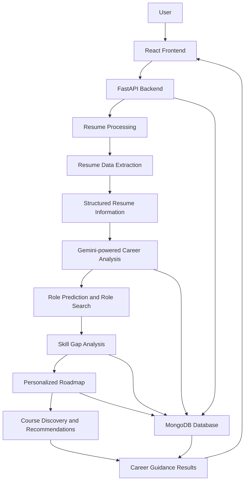
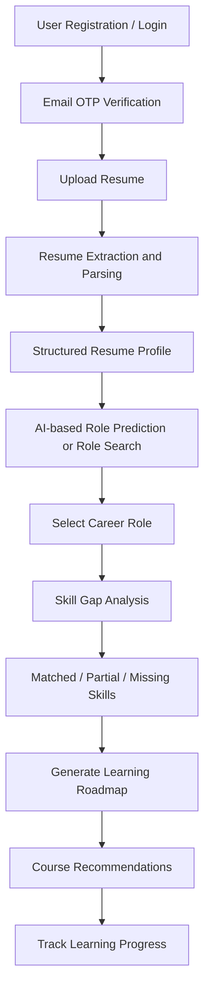

# SkillBridge – AI-Powered Resume Analysis & Career Guidance

SkillBridge is an AI-powered career guidance platform that helps users understand their professional profile, identify skill gaps, explore suitable career opportunities, and follow structured learning roadmaps.

The platform combines resume parsing, natural language processing, AI-based role prediction, skill gap analysis, personalized roadmaps, and course recommendations to support career development.

---

## 1. Project Overview

Choosing the right career path requires an understanding of existing skills, industry requirements, and the learning needed to bridge skill gaps.

SkillBridge addresses this challenge by analyzing a user's resume and providing career-related insights through an integrated AI-powered workflow.

The system helps users:

- Register and log in using an individual email address and SkillBridge password.
- Upload and analyze resumes.
- Extract structured information from resumes.
- Identify relevant career roles based on resume content.
- Search for career roles using a natural-language query.
- Compare existing skills with role-specific requirements.
- Identify matched, partially matched, and missing skills.
- Generate personalized learning roadmaps.
- Discover relevant certification courses and learning resources.
- Track progress through the recommended roadmap.

## 2. Key Features

### 2.1 User Registration and Email OTP Verification

- Users register with their own email address and a password created specifically for SkillBridge.
- A verification OTP is sent to the email address entered during registration.
- A centrally configured sender account delivers OTP messages; users do not provide their email-account passwords to SkillBridge.
- Email delivery is configured through SMTP environment variables.

### 2.2 Resume Upload and Analysis

- Supports PDF and DOCX resume formats.
- Extracts relevant information from uploaded resumes.
- Processes resume information into structured data.
- Identifies skills, education, experience, and project details.
- Makes the extracted information available for subsequent career analysis.

### 2.3 AI-Based Role Prediction

- Analyzes the candidate's resume information.
- Identifies relevant technical skills and professional experience.
- Predicts suitable career roles based on the candidate's profile.
- Provides role recommendations and fit scores to support career exploration.

### 2.4 Role Search

- Accepts a user's natural-language career-role search request.
- Uses the configured LLM provider to generate relevant professional roles.
- Returns role descriptions and related skills.

### 2.5 Skill Gap Analysis

- Evaluates the candidate's skills against the selected career role.
- Classifies competencies into matched, partially matched, and missing categories.
- Calculates a role-readiness score using the validated skill classifications.
- Identifies areas that require further learning and improvement.
- Displays a separate target benchmark score. The default target is 70%, configurable through `SKILL_GAP_BENCHMARK_SCORE`.

The current readiness scoring method assigns 100 points to a matched competency, 50 points to a partially matched competency, and 0 points to a missing competency, then averages the six assessed competencies. The target benchmark is a comparison value and does not change this calculation.

### 2.6 Personalized Learning Roadmap

- Generates a structured learning roadmap for the selected career role.
- Organizes required learning into phases.
- Provides a progression path based on identified skill gaps.
- Supports roadmap progress tracking.

### 2.7 Course Recommendations

- Recommends learning resources relevant to identified skill gaps.
- Includes certification-based and free learning resources where suitable results are found.
- Supports different learning levels.
- Connects course suggestions with the recommended learning roadmap.
- Checks course relevance and attempts to verify course URLs before including recommendations.

### 2.8 Progress Tracking

- Supports tracking of roadmap learning activities.
- Records completed skills and learning progress.
- Helps users monitor their progress towards career goals.

## 3. System Architecture

SkillBridge follows a modular client-server architecture.



### Architecture Components

| Component | Responsibility |
|---|---|
| Frontend | User interface, registration, resume upload, results, and progress display |
| Backend | API handling, authentication, workflow coordination, and business logic |
| Resume Processing | Resume text extraction, structured parsing, and skill identification |
| AI Services | Career prediction, role search, skill gap analysis, roadmap generation, and course discovery |
| Gemini API | Primary configured LLM provider for AI workflows |
| Ollama | Optional local LLM provider when explicitly selected in configuration |
| Database | Storage and retrieval of application data |
| Email Service | Sends registration OTPs through the centrally configured SMTP sender |

## 4. Technology Stack

| Layer | Technologies |
|---|---|
| Frontend | React.js, Vite, JavaScript, Tailwind CSS |
| Backend | Python, FastAPI |
| Database | MongoDB |
| Primary AI / LLM | Google Gemini API (Google AI Studio) |
| Optional local LLM | Ollama, Llama models (only when explicitly configured) |
| Resume Processing | pdfplumber, PyMuPDF, python-docx, pytesseract |
| NLP and Skill Matching | spaCy, RapidFuzz |
| Email | SMTP (Gmail SMTP configuration supported) |
| API Communication | REST APIs |
| Version Control | Git and GitHub |

## 5. AI and Machine Learning Components

### Resume Parsing

The resume-processing module extracts text from uploaded PDF and DOCX documents and converts the information into structured data.

### Gemini-powered LLM Service

The backend uses a central LLM client (`backend/app/services/llm_client.py`) so AI services can use the provider selected through `LLM_PROVIDER`. Gemini is the intended primary provider for the current setup. The model and thinking level can be configured through environment variables.

The central client also includes request pacing and retry handling to reduce bursts against API rate limits. These measures do not increase the quota assigned to a Google AI Studio project. Free-tier request and daily limits can still cause HTTP 429 responses.

### Role Prediction and Role Search

The role prediction service analyzes resume information and generates suitable career-role recommendations. Role Search interprets a user's search query and generates matching professional roles. Both use the configured central LLM client.

### Skill Gap Analysis

The skill gap analyzer compares the candidate's profile with the competencies required for a selected role. It classifies competencies as matched, partially matched, or missing and calculates the overall readiness percentage.

### Roadmap Generation and Course Discovery

The roadmap service uses the selected career role and identified skill requirements to generate a structured learning plan. Course discovery searches for relevant learning resources for roadmap skills and validates results before returning them.

## 6. Application Workflow



## 7. Project Structure

The repository is organized into separate frontend and backend components, with supporting machine-learning and resume-processing resources.

```text
skill_bridge/
│
├── backend/
│   ├── app/
│   │   ├── routes/
│   │   └── services/
│   ├── tests/
│   ├── main.py
│   ├── requirements.txt
│   ├── .env.example
│   └── .env                 # Local secrets; do not commit
│
├── frontend/
│   ├── src/
│   │   ├── api/
│   │   └── pages/
│   └── package.json
│
├── ml/                      # Supporting ML resources, if present in the checkout
│
└── README.md
```

*Note: This is a high-level representation. Individual files and folders may vary as the project evolves.*

## 8. Installation and Setup

### Prerequisites

Install the following software before running the project:

- Python (a version compatible with `backend/requirements.txt`).
- Node.js and npm.
- MongoDB.
- Git.
- A Google AI Studio API key for Gemini-powered features.
- A configured SMTP sender account for email OTP delivery.

Ollama is **not required** when `LLM_PROVIDER=gemini`.

### Step 1: Clone the Repository

```powershell
git clone https://github.com/Padmapv28/skill_bridge.git
cd skill_bridge
```

### Step 2: Backend Setup

```powershell
cd backend
python -m venv venv
.\venv\Scripts\Activate.ps1
pip install -r requirements.txt
```

Create the local environment file from the example:

```powershell
Copy-Item .env.example .env
```

Open `backend/.env` and configure the values described below. If the repository's `.env.example` does not yet contain a setting used by your checkout, add that setting to your local `.env` using the variable names supported by the backend configuration.

#### Gemini configuration

Create an API key in [Google AI Studio](https://aistudio.google.com/api-keys) and configure:

```env
LLM_PROVIDER=gemini
GEMINI_API_KEY=your_gemini_api_key
GEMINI_MODEL=your_available_gemini_model
GEMINI_THINKING_LEVEL=MINIMAL
```

Use a model available to your Google AI Studio project. The model shown in recent SkillBridge development logs was `gemini-3.6-flash`; model availability and quota depend on the Google project and account.

#### Skill Gap target benchmark

```env
SKILL_GAP_BENCHMARK_SCORE=70
```

This sets the target benchmark shown in the Skill Gap page. The default is 70 when the setting is omitted or invalid. It does not alter the readiness calculation.

#### Email OTP configuration

Configure one project-owned sender account. Users register with their own email addresses; the sender account is used by the backend to deliver OTP messages.

```env
SMTP_HOST=smtp.gmail.com
SMTP_PORT=465
SMTP_USER=your_project_sender@gmail.com
SMTP_PASSWORD=your_gmail_app_password
EMAIL_FROM=your_project_sender@gmail.com
OTP_DEV_MODE=False
```

For Gmail SMTP, use an App Password generated for the sender account (where available and eligible), not the account's normal sign-in password. Protect the sender account with 2-Step Verification. Never ask SkillBridge users to provide their Gmail passwords.

#### Database and application configuration

Configure the MongoDB connection, database name, JWT secret, and frontend origin using the variable names in `backend/app/config.py` and the supplied `.env.example`. A typical local MongoDB URI is:

```env
MONGO_URI=mongodb://localhost:27017
MONGO_DB_NAME=skillbridge
JWT_SECRET_KEY=replace-with-a-long-random-secret
JWT_EXPIRE_MINUTES=60
FRONTEND_ORIGIN=http://localhost:5173
```

Do not reuse the example JWT secret in a deployed environment.

### Step 3: Start MongoDB

Start the MongoDB service and confirm that it is reachable using the URI configured in `backend/.env`.

### Step 4: Start the Backend

From the `backend` directory with the virtual environment activated:

```powershell
python -m uvicorn main:app --host 127.0.0.1 --port 8000 --reload
```

Backend API:

```text
http://127.0.0.1:8000
```

Interactive API documentation:

```text
http://127.0.0.1:8000/docs
```

Keep the backend terminal open while using the application.

### Step 5: Frontend Setup

Open a second terminal at the project root:

```powershell
cd frontend
npm install
npm run dev
```

The frontend is generally available at:

```text
http://localhost:5173
```

## 9. Gemini API Request Limits

Gemini API usage is subject to the rate limits and quota assigned to the Google AI Studio project and selected model. The backend central LLM client spaces request starts and retries temporary failures to reduce request bursts.

- Request pacing is process-local; multiple backend instances or other applications using the same Google project can still contribute to the project's total usage.
- Request pacing cannot bypass a daily request quota or billing restriction.
- HTTP 429 indicates that a rate or quota limit may have been reached. Check the project's model-specific limits and usage in [Google AI Studio](https://aistudio.google.com/).
- Avoid repeatedly triggering the same AI workflow while a previous request is still running.

## 10. Optional Ollama Configuration

Gemini is the primary provider in the current SkillBridge setup. Ollama is optional and should only be used when deliberately selecting it.

To use Ollama instead, install and start Ollama, pull the model(s) configured by the application, and set the provider in the backend environment:

```env
LLM_PROVIDER=ollama
OLLAMA_MODEL=llama3.2:3b
OLLAMA_FAST_MODEL=llama3.2:1b
```

When using Gemini, keep `LLM_PROVIDER=gemini`; Ollama does not need to be running.

## 11. Testing

Run the available backend tests from the backend directory with the virtual environment activated:

```powershell
python -m pytest -q
```

Testing should cover the relevant areas, including:

- API request and response handling.
- Registration, login, and email OTP behavior.
- Resume processing.
- Role prediction and Role Search.
- Skill gap analysis and target benchmark display.
- Roadmap generation and course discovery.
- Progress-related functionality.

Live Gemini and SMTP tests require valid local environment configuration and may consume API quota or send real email messages. Run those tests deliberately.

## 12. Security and Data Handling

The application processes personal information contained in uploaded resumes and uses external services for selected AI and email workflows.

- Keep API keys, SMTP credentials, database credentials, and JWT secrets in `backend/.env` or another secure secret store.
- Never commit `.env` files or real credentials to GitHub.
- Keep `.env.example` limited to placeholder values.
- Confirm that `backend/.env` is ignored by Git before committing changes.
- Do not share Gemini API keys or Gmail App Passwords in screenshots, chat messages, source code, or issue trackers.
- Never ask users to provide their personal Gmail passwords. Users create a separate SkillBridge password.
- Protect uploaded resume information and user-specific career data.
- Validate uploaded files and API inputs and apply appropriate authentication and authorization checks.
- Review logging to avoid exposing personal information or secrets.

The application should be reviewed and security-tested before production deployment.

## 13. Project Advantages

- **AI-Based Career Guidance:** Helps users explore suitable career opportunities.
- **Personalized Skill Analysis:** Identifies the difference between existing and required skills.
- **Structured Learning Path:** Provides a roadmap for improving professional competencies.
- **Integrated Learning Resources:** Connects skill gaps with relevant courses.
- **Modular Architecture:** Separates frontend, backend, resume processing, and AI services.
- **Centralized LLM Configuration:** Routes supported AI workflows through a common provider interface.

## 14. Current Project Scope

SkillBridge integrates the following major workflows:

1. User Registration, Login, and Email OTP Verification.
2. Resume Upload and Parsing.
3. AI-Based Role Prediction.
4. Natural-language Role Search.
5. Skill Gap Analysis and Target Benchmark.
6. Personalized Roadmap Generation.
7. Course Discovery and Recommendations.
8. Learning Progress Tracking.

## 15. Future Enhancements

Potential enhancements include:

- Improved resume parsing for complex layouts.
- Expanded role and skills coverage.
- More comprehensive and consistently verified course recommendations.
- Enhanced learning progress analytics.
- Additional AI-assisted career guidance features.
- Performance, rate-limit, and deployment improvements.

## 16. Repository

**GitHub:** https://github.com/Padmapv28/skill_bridge

---

**SkillBridge – Bridging the Gap Between Skills and Career**
