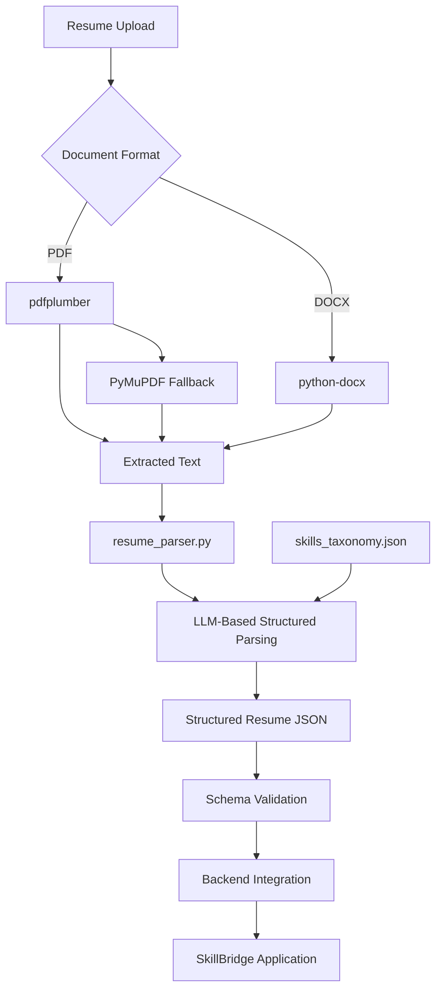
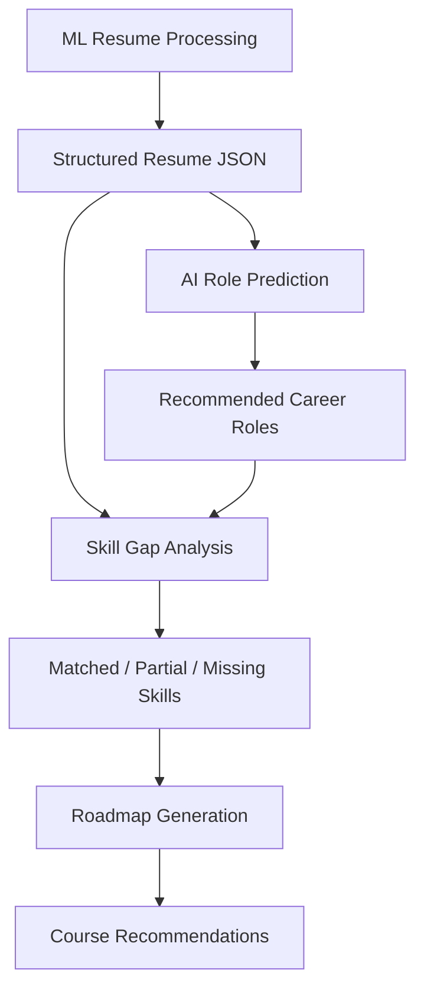

# Machine Learning Module – Resume Parsing and Data Extraction

The Machine Learning (ML) module is responsible for processing uploaded resumes and converting unstructured resume documents into structured information that can be used by the SkillBridge backend.

It supports resume text extraction, structured data parsing, and skill identification to enable downstream workflows such as AI-based role prediction and skill gap analysis.

**Module Ownership:** Member A

---

## 1. Module Overview

Resumes are commonly uploaded in different document formats and contain information in varying layouts.

The ML module processes these documents and extracts relevant candidate information, including:

- Personal and contact information.
- Educational qualifications.
- Technical and professional skills.
- Work experience.
- Projects and related details.

The extracted information is converted into structured JSON for integration with the backend and other SkillBridge components.

## 2. Main Responsibilities

The ML module performs the following tasks:

1. Accepts resume documents in supported formats.
2. Extracts text from PDF and DOCX files.
3. Processes the extracted text using structured parsing.
4. Identifies relevant candidate information.
5. Matches extracted skills against the skills taxonomy.
6. Produces structured JSON output.
7. Makes the processed resume information available to the backend.

## 3. Module Architecture



## 4. Technologies and Libraries

| Technology | Purpose |
|---|---|
| Python | Core implementation language |
| pdfplumber | PDF text extraction |
| PyMuPDF | Alternative PDF extraction |
| python-docx | DOCX document processing |
| LLM-based parsing | Structured extraction of resume information |
| JSON | Structured resume output and skill taxonomy |
| FastAPI | Resume-processing API integration |

## 5. Module Components

| File / Resource | Responsibility |
|---|---|
| `resume_extractor.py` | Extracts raw text from PDF and DOCX resumes |
| `resume_parser.py` | Converts extracted text into structured resume information |
| `skills_taxonomy.json` | Contains 524 curated skills used for skill matching |
| `main.py` | FastAPI application exposing the resume upload endpoint |
| `docs/resume_fields.md` | Documents the expected structured resume JSON schema |
| Sample resumes | Test documents containing different resume formats |

## 6. Resume Processing Workflow

### Step 1: Resume Upload

The user uploads a resume through the SkillBridge application.

The module supports:

- PDF
- DOCX

### Step 2: Text Extraction

The `resume_extractor.py` component extracts text from the uploaded document.

The extraction process uses:

- **pdfplumber:** Primary PDF text extraction.
- **PyMuPDF:** Fallback for PDFs that require alternative extraction.
- **python-docx:** Text extraction from Word documents.

The extracted text is passed to the parsing component.

### Step 3: Structured Resume Parsing

The `resume_parser.py` component processes the extracted resume text using an LLM-based structured extraction prompt.

The objective is to identify and organize information into fields such as:

- Candidate name.
- Contact information.
- Education.
- Skills.
- Experience.
- Projects.

### Step 4: Skills Identification

The extracted skills are matched against the project's curated skills taxonomy.

The taxonomy contains 524 skills and supports consistent skill identification for downstream career analysis.

### Step 5: JSON Generation

The parsed information is organized into structured JSON.

The output follows the shared schema documented in:

```text
docs/resume_fields.md
```

### Step 6: Backend Integration

The FastAPI application exposes the resume upload endpoint:

```text
POST /api/upload-resume
```

The structured resume information is returned to the application for further processing.

---

## 7. Integration with Other SkillBridge Modules

The ML module provides structured resume information that supports the other major SkillBridge workflows.



### Integration Responsibilities

| Module | How Resume Data Is Used |
|---|---|
| Role Prediction | Identifies suitable career roles based on the candidate profile |
| Skill Gap Analysis | Compares extracted candidate skills with role requirements |
| Roadmap Generation | Uses identified skill gaps to support learning-plan generation |
| Course Recommendations | Connects missing skills with relevant learning resources |

The ML module focuses on resume extraction and structured data preparation. Career-role prediction, skill gap analysis, and roadmap generation are handled by their respective application services.

## 8. Testing and Validation

The original module testing documentation records the following validation activities:

- All 26 sample resumes were validated end-to-end.
- Six real-world resume formats were used during debugging.
- The live API was tested through Swagger UI.
- Successful `200` responses and validation-related `422` responses were confirmed.

These tests were intended to validate document extraction, structured parsing, and API behavior across different resume inputs.

## 9. Known Limitations

### Two-Column Resume PDFs

Some two-column PDF resumes may produce text in an incorrect reading order.

This can occur because PDF text extraction tools do not always preserve the visual layout of multi-column documents.

**Impact:** Incorrect text order can affect the quality of the extracted resume information.

**Possible Improvement:** Introduce layout-aware extraction and additional document preprocessing for complex resume formats.

## 10. Installation and Execution

### Prerequisites

- Python
- Required Python packages
- Access to the configured parsing service or LLM
- Resume documents in supported formats

### Install Dependencies

From the appropriate ML module directory:

```bash
pip install -r requirements.txt
```

*Use the requirements file provided in the actual ML module.*

### Run the ML Application

The module's `main.py` provides the FastAPI application for resume processing.

Run it using the project's configured execution command. When integrated into the main SkillBridge application, the backend manages the resume-processing workflow.

### API Documentation

When the API service is running, its Swagger documentation can be accessed through:

```text
http://localhost:8000/docs
```

The resume upload endpoint is:

```text
POST /api/upload-resume
```

## 11. Input and Output

**Input:** PDF or DOCX resume documents.

**Processing:**
- Text extraction.
- Structured information parsing.
- Skill identification.
- JSON preparation.

**Output:** Structured resume information containing candidate details, education, skills, experience, and project information according to the shared schema.

## 12. Future Improvements

Potential improvements to the ML module include:

- Better extraction from two-column and complex-layout resumes.
- Improved handling of scanned PDF documents.
- Enhanced OCR integration where required.
- Expanded skills taxonomy.
- Improved validation of extracted fields.
- Better handling of incomplete or inconsistent resume information.
- Additional resume-format test cases.

## 13. Module Summary

The ML module acts as the resume-processing foundation of SkillBridge. It converts unstructured PDF and DOCX resumes into structured candidate information, enabling the platform's AI-powered career guidance workflows.

**Module Status:** Resume extraction, structured parsing, skills taxonomy matching, and API integration are documented as completed in the existing module records.

---

**SkillBridge ML Module – Transforming Resume Documents into Structured Career Data.**